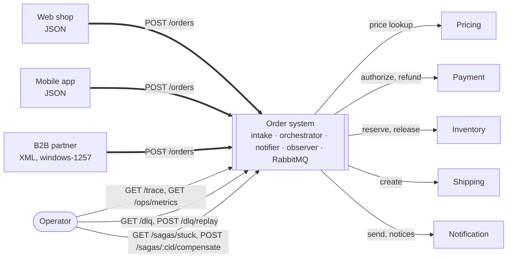
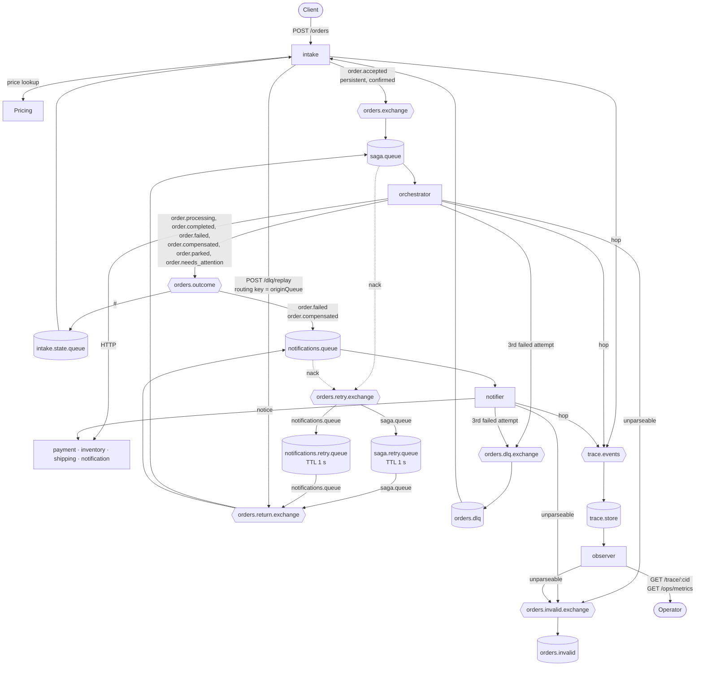

# Architecture

Two views of the same system. The first is the system from outside. The second is what happens inside it: every exchange and queue, the retry path, the dead letter and invalid channels, the outcome events and the wire tap.

## System context

Orders arrive from three sources in three formats. The system calls one pricing service before it accepts an order, and four providers while it runs one. An operator reads the trace and the metrics, and acts on stuck sagas and dead-lettered messages.

## Integration architecture

Intake translates, prices and publishes `order.accepted` to `orders.exchange`. The orchestrator consumes `saga.queue` and runs the saga. It publishes lifecycle and outcome events to `orders.outcome`. Intake follows `#` there through its own `intake.state.queue`, which is not in the shipped topology, to keep `GET /orders` current. The notifier consumes `order.failed` and `order.compensated` from `notifications.queue`. Every service publishes hop records to `trace.events`, and the observer reads `trace.store`.

A temporary failure is rejected into the origin queue's retry queue. After one second it returns through `orders.return.exchange` to that queue only. After the third failed attempt the message goes to `orders.dlq.exchange` and then `orders.dlq`. A message that cannot be parsed goes to `orders.invalid.exchange` and then `orders.invalid`, and is never retried.

